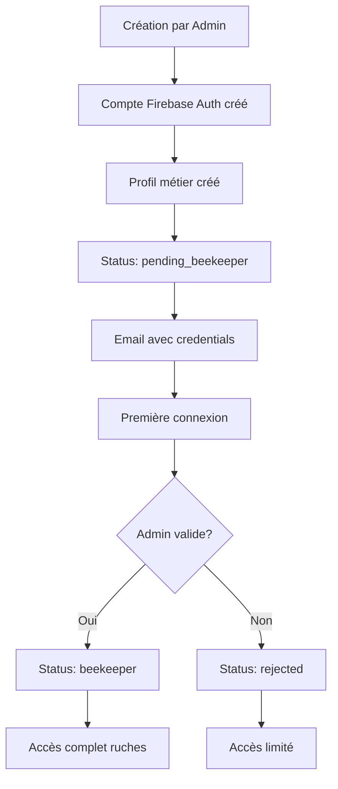
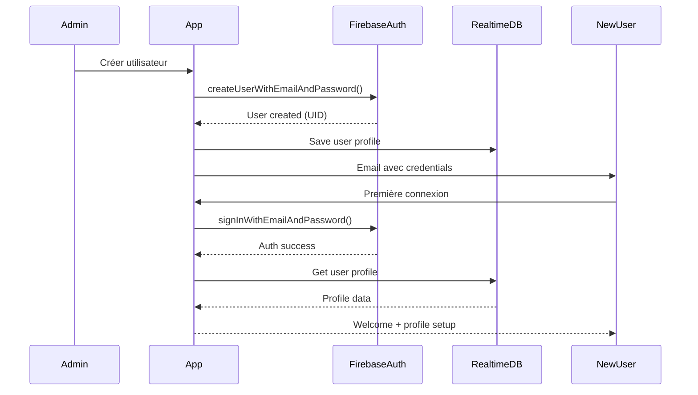

# Architecture d'Authentification - Ruche Connectée

## 🏗️ **Vue d'Ensemble**

Cette documentation explique l'architecture d'authentification hybride mise en place pour gérer les différents types d'utilisateurs dans l'application Ruche Connectée.

## 🔑 **Approche Hybride Firebase Auth + Profils Métier**

### **Principe Fondamental**

Tous les utilisateurs, qu'ils soient créés par un admin ou qu'ils s'inscrivent eux-mêmes, passent par **Firebase Auth** pour l'authentification. Cette approche garantit :

- ✅ **Sécurité maximale** (hachage des mots de passe, protection contre les attaques)
- ✅ **Scalabilité** (gestion des millions d'utilisateurs)
- ✅ **Fonctionnalités avancées** (réinitialisation de mot de passe, 2FA future)
- ✅ **Cohérence** dans la gestion des sessions

### **Architecture en Couches**

```
┌─────────────────────────────────────────────────────────────┐
│                    APPLICATION LAYER                        │
├─────────────────────────────────────────────────────────────┤
│  🔐 FIREBASE AUTH (Authentification)                       │
│  • Stockage sécurisé des credentials                       │
│  • Gestion des sessions et tokens                          │
│  • Réinitialisation de mots de passe                       │
│  • Validation des emails                                   │
├─────────────────────────────────────────────────────────────┤
│  👤 REALTIME DATABASE (Profils Métier)                     │
│  • Informations personnelles étendues                      │
│  • Rôles et permissions                                    │
│  • Détails spécifiques apiculteur                          │
│  • Historique et audit trail                               │
└─────────────────────────────────────────────────────────────┘
```

## 👥 **Types d'Utilisateurs et Workflows**

### **1. Administrateurs/Super Admins (Comptes Existants)**

**Situation :** Vous avez déjà un compte Firebase Auth dans votre projet.

**Workflow de connexion :**

```dart
// 1. Connexion Firebase Auth standard
final authResult = await authService.signInWithEmailAndPassword(
  email: 'admin@ruche.com',
  password: 'votre_mot_de_passe',
);

// 2. Récupération/Création automatique du profil admin
if (authResult is AuthSuccess) {
  final profile = await userProfileRepository.getUserProfile(user.uid);

  if (profile == null) {
    // Création automatique d'un profil admin
    final adminProfile = UserProfileEntity(
      userId: user.uid,
      email: user.email,
      role: UserRoleEntity(roleType: UserRoleType.admin),
      // ... autres champs
    );
    await userProfileRepository.createUserProfile(adminProfile);
  }
}
```

### **2. Apiculteurs Créés par Admin**

**Workflow de création par admin :**

```dart
// 1. Admin crée le compte Firebase Auth
final result = await authService.createUserByAdmin(
  email: 'apiculteur@example.com',
  fullName: 'Jean Dupont',
);

if (result is AuthSuccess) {
  // 2. Création du profil métier complet
  final profile = UserProfileEntity(
    userId: result.data.uid,
    firstName: 'Jean',
    lastName: 'Dupont',
    email: 'apiculteur@example.com',
    role: UserRoleEntity(
      roleType: UserRoleType.pendingBeekeeper,
      assignedBy: adminId,
    ),
    // ... autres champs
  );

  await userProfileRepository.createUserProfile(profile);

  // 3. Email automatique avec mot de passe temporaire
  // (géré par le service ou Firebase Functions)
}
```

**Workflow de première connexion :**

```dart
// L'apiculteur reçoit un email avec :
// - Son email : apiculteur@example.com
// - Mot de passe temporaire : TempPass123!
// - Lien vers l'application

// Première connexion
final authResult = await authService.signInWithEmailAndPassword(
  email: 'apiculteur@example.com',
  password: 'TempPass123!',
);

// Option de changement de mot de passe
if (needsPasswordChange) {
  await authService.updatePassword(
    newPassword: 'nouveau_mot_de_passe_securise',
  );
}
```

### **3. Futurs Utilisateurs Auto-Inscrits**

**Workflow d'inscription libre (à implémenter plus tard) :**

```dart
// 1. Inscription Firebase Auth
final authResult = await authService.signUp(
  email: 'nouveau@example.com',
  password: 'mot_de_passe',
);

// 2. Création automatique du profil de base
final profile = UserProfileEntity(
  userId: authResult.user.uid,
  role: UserRoleEntity(roleType: UserRoleType.pendingBeekeeper),
  // Statut : en attente de validation admin
);
```

## 🔐 **Avantages de cette Architecture**

### **Sécurité Renforcée**

- 🛡️ **Mots de passe hashés** par Firebase (bcrypt/scrypt)
- 🔒 **Protection CSRF/XSS** native
- 🚫 **Rate limiting** automatique contre les attaques
- 🔐 **Tokens JWT** sécurisés pour les sessions

### **Gestion Simplifiée**

- 📧 **Reset de mot de passe** automatique par email
- ✅ **Validation d'email** intégrée
- 🔄 **Sessions persistantes** sur tous les appareils
- 📱 **Support multi-plateformes** (iOS, Android, Web)

### **Évolutivité**

- 🔢 **Millions d'utilisateurs** supportés
- 🌍 **Distribution géographique** automatique
- ⚡ **Performance optimisée** par Google
- 🔧 **Fonctionnalités futures** (2FA, OAuth social)

## 📊 **Matrices de Permissions**

### **Actions par Type d'Utilisateur**

| Action                 | Utilisateur Standard | Apiculteur | Admin | Super Admin |
| ---------------------- | -------------------- | ---------- | ----- | ----------- |
| Se connecter           | ✅                   | ✅         | ✅    | ✅          |
| Voir son profil        | ✅                   | ✅         | ✅    | ✅          |
| Modifier son profil    | ✅                   | ✅         | ✅    | ✅          |
| Accéder aux ruches     | ❌                   | ✅         | ✅    | ✅          |
| Créer des utilisateurs | ❌                   | ❌         | ✅    | ✅          |
| Gérer les validations  | ❌                   | ❌         | ✅    | ✅          |
| Soft delete            | ❌                   | ❌         | ✅    | ✅          |
| Suppression définitive | ❌                   | ❌         | ❌    | ✅          |

### **Workflow de Validation**



## 🛠️ **Implémentation Technique**

### **AuthService Simplifié**

```dart
class AuthService {
  // Connexion standard (tous utilisateurs)
  Future<AuthResult<User>> signInWithEmailAndPassword({
    required String email,
    required String password,
  });

  // Création par admin (génère mot de passe temporaire)
  Future<AuthResult<User>> createUserByAdmin({
    required String email,
    required String fullName,
  });

  // Utilitaires
  Future<void> signOut();
  Future<AuthResult<void>> resetPassword({required String email});
  Future<AuthResult<void>> updatePassword({required String newPassword});
}
```

### **UserProfileRepository Complet**

```dart
class UserProfileRepositoryImpl {
  // CRUD de base
  Future<UserProfileResult<UserProfileEntity>> getUserProfile(String userId);
  Future<UserProfileResult<UserProfileEntity>> createUserProfile(UserProfileEntity profile);
  Future<UserProfileResult<UserProfileEntity>> updateUserProfile(UserProfileEntity profile);

  // Gestion administrative
  Future<UserProfileResult<List<UserProfileEntity>>> getAllBeekeepers();
  Future<UserProfileResult<UserProfileEntity>> validateBeekeeper(String userId, bool approved);

  // Soft delete (architecture déjà implémentée)
  Future<UserProfileResult<UserProfileEntity>> softDeleteUserProfile(String userId, DeletionInfo info);
  Future<UserProfileResult<UserProfileEntity>> restoreUserProfile(String userId, RestorationInfo info);
}
```

## 🔄 **Flux d'Authentification Complet**

### **Diagramme de Séquence**



## 🚀 **Prochaines Étapes**

### **Phase 1 : Implémentation Actuelle**

- [x] AuthService simplifié
- [x] Architecture soft delete
- [ ] Écran de création utilisateur
- [ ] Intégration complète UserProfileRepository

### **Phase 2 : Fonctionnalités Avancées**

- [ ] Email templates personnalisés
- [ ] Interface de validation des apiculteurs
- [ ] Dashboard admin complet
- [ ] Audit trail des créations

### **Phase 3 : Sécurité Renforcée**

- [ ] 2FA (Two-Factor Authentication)
- [ ] OAuth social (Google, Apple)
- [ ] Politique de mots de passe avancée
- [ ] Détection d'anomalies

## 💡 **Questions Fréquentes**

### **Q: Pourquoi Firebase Auth pour tous les utilisateurs ?**

**R:** Firebase Auth offre une sécurité de niveau entreprise avec des fonctionnalités avancées (reset password, 2FA, etc.) qu'il serait coûteux et risqué de recréer.

### **Q: Comment gérer les mots de passe temporaires ?**

**R:** Ils sont générés automatiquement par l'application et communiqués par email sécurisé. L'utilisateur peut les changer dès la première connexion.

### **Q: Peut-on supprimer un utilisateur Firebase Auth ?**

**R:** Techniquement oui, mais nous utilisons le soft delete pour préserver les données et permettre les rollbacks. La suppression définitive nécessite des permissions super admin.

### **Q: Comment gérer la concurrence (plusieurs admins) ?**

**R:** Le système utilise l'optimistic locking avec un champ `version` pour détecter et gérer les modifications concurrentes.

---

**Documentation maintenue par l'équipe de développement RC Mobile App**  
_Dernière mise à jour : Décembre 2025_
